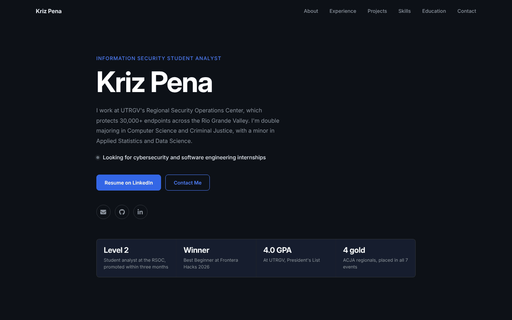

# Portfolio

My personal website: [krizzzp1.github.io/Portfolio](https://krizzzp1.github.io/Portfolio/)



It covers my work at UTRGV's Regional Security Operations Center, my projects, skills, and education. Built with HTML, CSS, and a little JavaScript, and hosted on GitHub Pages from the `main` branch.

## Privacy and security

- No cookies, analytics, or trackers.
- The font and icons are stored in this repo, so the page never contacts another server.
- A Content Security Policy only lets the page load its own files.

## Run it locally

From this folder in PowerShell:

```powershell
python -m http.server 8000
```

Then open http://localhost:8000. Press Ctrl+C in the terminal to stop it.

## Files

| File | What it is |
| --- | --- |
| `index.html` | The page |
| `styles.css` | Layout, colors, phone layout and print layout |
| `script.js` | Phone menu, header, back-to-top button and menu highlighting |
| `404.html` | The page GitHub Pages shows for a broken link |
| `vm-lab-manual.pdf` | The build manual for the Isolated VM Attack Lab project |
| `images/` | Project screenshot |
| `fonts/` | The Inter font and its license |
| `og-image.png` | The picture shown when the link is shared |
| `docs/screenshot.png` | The screenshot above |

## Credits

- [Inter](https://rsms.me/inter/) font by Rasmus Andersson, SIL Open Font License 1.1 (`fonts/OFL.txt`)
- Icons from [Font Awesome Free](https://fontawesome.com) 6.4.0, CC BY 4.0

Last updated: November 2026
